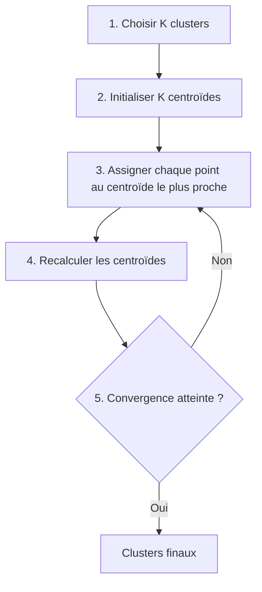
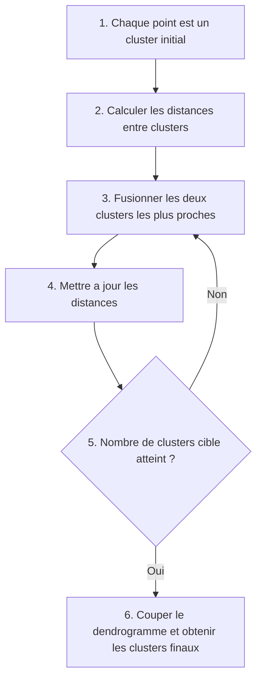
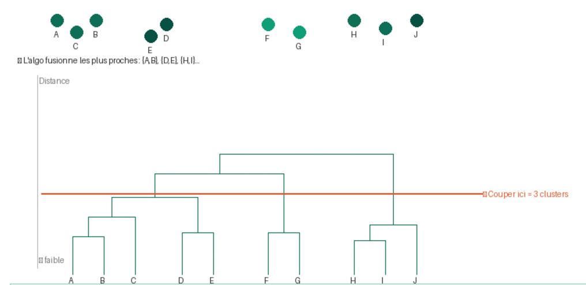
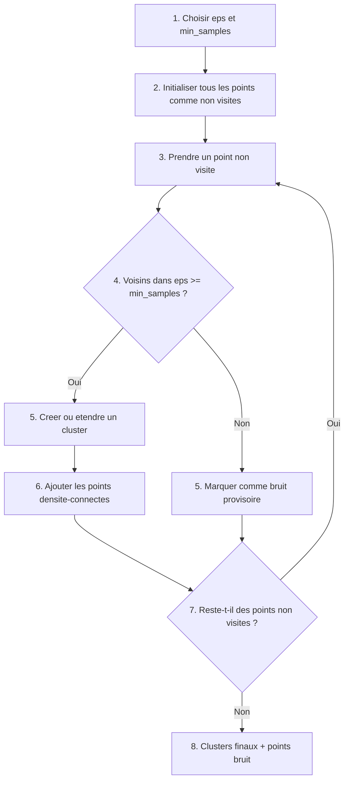
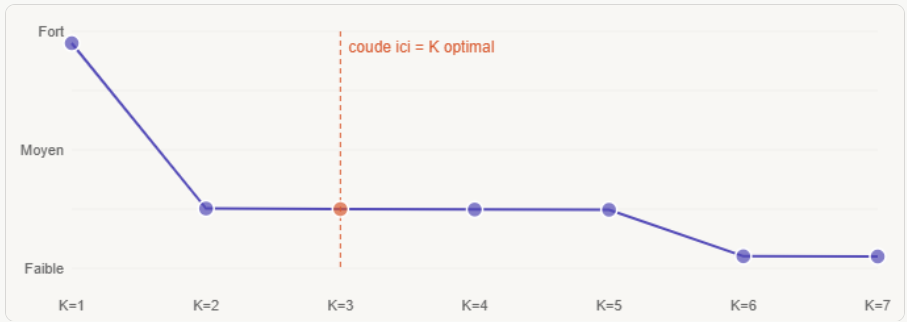
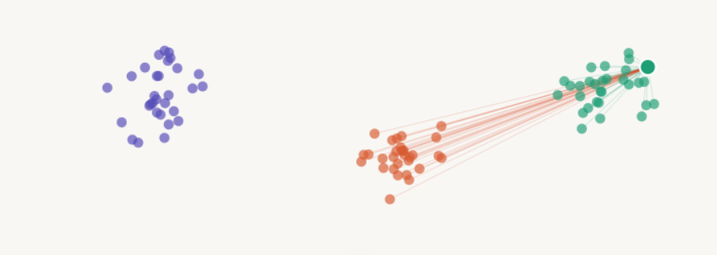

# Veille technique

[← Retour au README](../README.md)

Veille réalisée en début de projet (juin 2026), avant le travail sur les données. Elle couvre l'apprentissage non supervisé, les principaux algorithmes de clustering, le choix du nombre de clusters et les mesures de qualité.

- [Partie A — Synthèse](#partie-a--synthèse)
- [Partie B — Schémas de fonctionnement et sources](#partie-b--schémas-de-fonctionnement-et-sources)

---

# Partie A — Synthèse

*Rédaction : Axel Achart.*

## Regroupement non supervisé

Le regroupement non supervisé, aussi appelé classification non supervisée, consiste à rassembler des données non étiquetées en groupes homogènes à partir de leurs similitudes, sans qu'un modèle ait été préalablement entraîné sur des exemples connus.

Source : [Google Cloud](https://cloud.google.com/discover/supervised-vs-unsupervised-learning?hl=fr)

---

## Clustering

Le clustering est une technique de machine learning non supervisée conçue pour regrouper des exemples non étiquetés en fonction de leur similarité. Il permet d'identifier des tendances et des structures cachées dans les données.

Source : [Google ML Glossary](https://developers.google.com/machine-learning/clustering/overview?hl=fr)

---

## Algorithmes de classification non supervisée

La classification non supervisée regroupe les données sans étiquettes connues à l'avance. Les algorithmes se répartissent en plusieurs familles :

**- Par partitionnement (centroïdes)**

**K-Means** : regroupe les points en K groupes selon leur proximité au centroïde de chaque cluster. C'est la méthode de partitionnement la plus répandue en machine learning.

**- Par hiérarchie (dendrogramme CAH)**

**Clustering hiérarchique ascendant (agglomératif)** : chaque exemple démarre dans son propre cluster, puis les clusters les plus proches sont fusionnés itérativement pour former un arbre hiérarchique.

**Clustering hiérarchique descendant (divisif)** : tous les exemples sont regroupés en un seul cluster, puis divisés itérativement.

**- Par densité**

**DBSCAN** : identifie des clusters en se basant sur la densité des points, ce qui permet de détecter des formes arbitraires et de gérer efficacement les points de bruit.

**OPTICS** : extension de DBSCAN qui gère mieux les clusters de densités variables.

---

## Fonctionnement de 3 algorithmes

**- K-Means**

L'algorithme initialise K centroïdes (aléatoirement ou issus du dataset), puis itère jusqu'à convergence :

1. Chaque point est assigné au centroïde le plus proche.
2. Les centroïdes sont recalculés comme la moyenne des points du cluster.
3. On répète jusqu'à stabilisation.

Avantage : simple, rapide et scalable. Limite : K doit être fixé à l'avance ; sensible aux outliers et aux formes non convexes.

**- Clustering hiérarchique ascendant**

Chaque point démarre dans son propre cluster. On calcule la matrice de ressemblance entre tous les couples, puis on fusionne itérativement les deux clusters les plus proches. Le résultat est un dendrogramme que l'on coupe à la hauteur voulue pour obtenir le nombre de clusters souhaité.

Avantage : pas besoin de fixer K a priori ; visualisation intuitive. Limite : coûteux en mémoire et en calcul sur de grands datasets.

**- DBSCAN**

Deux paramètres gouvernent l'algorithme : ε (distance maximale entre deux points voisins) et MinPts (nombre minimum de points pour former un cluster dense).

1. Un point avec au moins MinPts voisins dans un rayon ε est un point central (core point).
2. L'algorithme explore les voisins et ajoute les points éligibles au cluster.
3. Les points n'appartenant à aucun cluster sont marqués comme bruit (noise).

Avantage : détecte des formes quelconques, isole les outliers naturellement, ne nécessite pas de fixer K. Limite : peu efficace quand les clusters ont des densités variables ; difficile à paramétrer en haute dimension.

---

## Méthodes de sélection du nombre optimal de clusters

**Méthode du coude (Elbow Method)** : méthode graphique qui trace l'inertie en fonction du nombre de clusters K. On recherche le point d'inflexion (le "coude") où l'ajout d'un cluster supplémentaire n'apporte plus de gain significatif.
Source : [IBM](https://www.ibm.com/fr-fr/think/topics/k-means-clustering)

**Score de silhouette** : mesure la similarité d'un point avec son propre cluster par rapport aux autres clusters. Plus le score est élevé, meilleur est le clustering.
Source : [Medium – therised](https://therised.medium.com/determining-the-number-of-clusters-a-comprehensive-guide-1a2441c5a526)

**Statistiques d'écart (Gap Statistics)** : compare les performances du clustering sur les données réelles à celles obtenues sur des données aléatoires, afin de déterminer si la structure identifiée est réelle.
Source : [Medium – therised](https://therised.medium.com/determining-the-number-of-clusters-a-comprehensive-guide-1a2441c5a526)

---

## Mesures de qualité d'un cluster

Les métriques internes évaluent la qualité du clustering sans étiquettes de référence. Ce sont les seules disponibles dans un contexte vraiment non supervisé.

**Silhouette Score**

Pour chaque point i, on calcule a(i) (distance moyenne au sein de son cluster) et b(i) (distance moyenne au cluster le plus proche). Le score est : `s(i) = (b(i) - a(i)) / max(a(i), b(i))`, et varie de −1 à +1.

| Score | Interprétation |
|---|---|
| Proche de +1 | Bien clusterisé |
| Autour de 0 | Proche d'une frontière |
| Proche de −1 | Probablement mal classé |

Source : Peter Rousseeuw, 1987 (Wikipedia / arXiv)

---
**Indice Davies-Bouldin (DBI)**

Mesure la similarité moyenne entre chaque cluster et son plus proche voisin, en comparant le rapport dispersion interne / distance entre centroïdes. Une valeur plus basse indique une meilleure qualité de clustering.
Source : scikit-learn docs / GeeksforGeeks / arXiv

**Inertie (Within-Cluster Sum of Squares)**

Somme des distances au carré entre chaque point et le centroïde de son cluster. Une forte inertie inter-classes traduit une bonne séparation des clusters, tandis qu'une faible inertie intra-classe traduit leur compacité. Utilisée notamment pour la méthode du coude.
Source : HAL

**Calinski-Harabasz Index**

Mesure le rapport entre la variance inter-clusters et la variance intra-cluster. Un score plus élevé signifie des clusters compacts et bien séparés. Cet indice aide à déterminer le nombre idéal de clusters.
Source : GeeksforGeeks

---

# Partie B — Schémas de fonctionnement et sources

*Rédaction : Hippolyte Geslain et Kylliann Larcher.*

Un algorithme de classification non supervisée aussi appelé apprentissage non supervisé consiste à laisser un algorithme trouver tout seul des groupes dans les données sans étiquettes connues à l'avance.

## Processus:

## Algorithme de classification non supervisée

### K-Means

Le K-Means est un algorithme de clustering non supervisé qui regroupe automatiquement les données en K clusters selon leur similarité en minimisant la distance entre chaque point et le centre de son cluster.

### Schéma de fonctionnement (étape par étape)

### Source:
1. Scikit-learn, Unsupervised learning (vue d'ensemble)  
https://scikit-learn.org/stable/unsupervised_learning.html

2. Scikit-learn, Clustering (inclut K-Means et son principe itératif)  
https://scikit-learn.org/stable/modules/clustering.html

3. Scikit-learn, KMeans API (paramètres, convergence, implémentation)  
https://scikit-learn.org/stable/modules/generated/sklearn.cluster.KMeans.html

4. MacQueen, J. (1967), Some Methods for Classification and Analysis of Multivariate Observations (papier fondateur de K-Means)  
https://projecteuclid.org/euclid.bsmsp/1200512992

5. Lloyd, S. (1982), Least Squares Quantization in PCM (algorithme de Lloyd souvent associé à K-Means)  
https://ieeexplore.ieee.org/document/1056489

6. Arthur, D. and Vassilvitskii, S. (2007), k-means++: The Advantages of Careful Seeding  
https://theory.stanford.edu/~sergei/papers/kMeansPP-soda.pdf

### La CAH (Classification Ascendante Hiérarchique)

Une méthode de clustering non supervisé qui regroupe progressivement les points les plus proches pour construire un dendrogramme, puis le coupe à un niveau choisi pour obtenir les clusters.

### Schéma de fonctionnement (étape par étape)

### Sources CAH:
1. Scikit-learn, Clustering hiérarchique
https://scikit-learn.org/stable/modules/clustering.html#hierarchical-clustering

2. Scikit-learn, AgglomerativeClustering (API)
https://scikit-learn.org/stable/modules/generated/sklearn.cluster.AgglomerativeClustering.html

3. SciPy, cluster.hierarchy (linkage, dendrogram)
https://docs.scipy.org/doc/scipy/reference/cluster.hierarchy.html

4. Ward, J. H. (1963), Hierarchical Grouping to Optimize an Objective Function
https://doi.org/10.1080/01621459.1963.10500845

### DBSCAN

Le DBSCAN est un algorithme de clustering non supervisé basé sur la densité, qui regroupe les points proches en clusters et identifie les points isolés comme du bruit.

### Paramètres clés

1. eps (epsilon): rayon de voisinage autour d'un point.
2. min_samples: nombre minimum de points dans ce rayon pour qu'un point soit considéré comme un point coeur.

### Schéma de fonctionnement (étape par étape)

### Sources DBSCAN:
1. Scikit-learn, DBSCAN (section Clustering)
https://scikit-learn.org/stable/modules/clustering.html#dbscan

2. Scikit-learn, DBSCAN API
https://scikit-learn.org/stable/modules/generated/sklearn.cluster.DBSCAN.html

3. Ester, M., Kriegel, H.-P., Sander, J., Xu, X. (1996), A Density-Based Algorithm for Discovering Clusters in Large Spatial Databases with Noise
https://cdn.aaai.org/KDD/1996/KDD96-037.pdf

4. Schubert, E. et al. (2017), DBSCAN Revisited, Revisited
https://doi.org/10.1145/3068335

## Quelles sont les méthodes de sélection du nombre optimal de clusters et la mesure de qualité d'un cluster.

L'idée centrale est simple : tu as des données, tu veux les regrouper automatiquement, mais tu ne sais pas en combien de groupes. Le clustering c'est ça — et les méthodes dont on parle servent à répondre à cette question.

On commence par le problème du choix de K :

**Méthode du coude** : on essaie K = 1, 2, 3, 4… et on mesure à chaque fois l'inertie (la somme des distances de chaque point à son centroïde). Naturellement l'inertie baisse quand K augmente — mais à partir d'un certain K, le gain devient minuscule. Ce "coude" indique le bon K.

**la méthode du score de silhouette**: c'est la plus fiable. Pour chaque point, on regarde deux choses : est-il proche des autres points de son groupe ? Et est-il loin du groupe voisin ? Si oui, son score est proche de +1. Si non (il est mal classé), son score est proche de -1.

Maintenant qu'on a des clusters, comment savoir s'ils sont bons ?

Il faut verifier 2 choses :
1. **Compacite** : les points d'un meme cluster sont proches entre eux.
2. **Separation** : les clusters sont bien eloignes les uns des autres.

## Comment fonctionnent les 3 methodes de mesure de qualite

1. **Silhouette**

Pour chaque point, on compare :
- sa distance moyenne a son propre cluster
- sa distance moyenne au cluster voisin le plus proche

Si le point est bien place, il est proche de son cluster et loin des autres.

Interpretation :
- proche de **1** : tres bon
- proche de **0** : clusters qui se chevauchent
- negatif : point souvent mal classe

Regle simple : **plus grand = mieux**.

2. **Davies-Bouldin**

On regarde si les clusters sont :
- compacts a l'interieur
- bien separes entre eux

Le score compare la dispersion interne des clusters a la distance entre leurs centres.

Regle simple : **plus petit = mieux**.

3. **Calinski-Harabasz**

Cette methode compare :
- la separation entre clusters
- la dispersion a l'interieur des clusters

Si les clusters sont loin les uns des autres et serres a l'interieur, le score augmente.

Regle simple : **plus grand = mieux**.

4. **Statistique d'écart (Gap Statistic)**

Méthode proposée par Tibshirani, Walther & Hastie (2001). L'idée est de comparer l'inertie
observée sur les vraies données à l'inertie attendue si les données étaient uniformément
distribuées (absence de structure de clusters).

Principe :
1. On calcule l'inertie W_k du clustering sur les données réelles
2. On génère B jeux de données de référence uniformément répartis dans le même espace (min/max)
3. Pour chaque jeu de référence, on applique K-means et on calcule son inertie W*_k
4. Gap(K) = (1/B) × Σ log(W*_k) − log(W_k)

Si Gap(K) est élevé, cela signifie que l'inertie observée est bien plus petite que l'inertie
attendue sous hypothèse nulle → il existe une vraie structure de clusters.

Regle simple : **plus grand = mieux**.

## Comment choisir K en pratique

1. Tester plusieurs valeurs de K (ex: 2 a 10).
2. Regarder la **methode du coude** pour trouver une zone plausible.
3. Verifier avec la **silhouette** (prendre un K avec un score eleve).
4. Confirmer avec le **Gap Statistic**, Davies-Bouldin et Calinski-Harabasz.
5. Garder un K interpretable metier (segments utiles pour l'analyse).

En resume :
- **Coude** sert surtout a choisir le nombre de clusters.
- **Silhouette / Davies-Bouldin / Calinski-Harabasz / Gap Statistic** servent a juger la qualite du clustering.

## Sources (selection de K et mesure de qualite)

1. Scikit-learn, KMeans (inertie / choix de K):
https://scikit-learn.org/stable/modules/generated/sklearn.cluster.KMeans.html

2. Scikit-learn, silhouette_score:
https://scikit-learn.org/stable/modules/generated/sklearn.metrics.silhouette_score.html

3. Scikit-learn, davies_bouldin_score:
https://scikit-learn.org/stable/modules/generated/sklearn.metrics.davies_bouldin_score.html

4. Scikit-learn, calinski_harabasz_score:
https://scikit-learn.org/stable/modules/generated/sklearn.metrics.calinski_harabasz_score.html

5. Rousseeuw, P. J. (1987), Silhouettes: a Graphical Aid to the Interpretation and Validation of Cluster Analysis:
https://www.sciencedirect.com/science/article/pii/0377042787901257

6. Davies, D. L. and Bouldin, D. W. (1979), A Cluster Separation Measure:
https://ieeexplore.ieee.org/document/4766909

7. Calinski, T. and Harabasz, J. (1974), A Dendrite Method for Cluster Analysis:
https://www.tandfonline.com/doi/abs/10.1080/03610927408827101

8. Tibshirani, R., Walther, G., and Hastie, T. (2001), Estimating the number of clusters in a data set via the gap statistic:
https://doi.org/10.1111/1467-9868.00293
